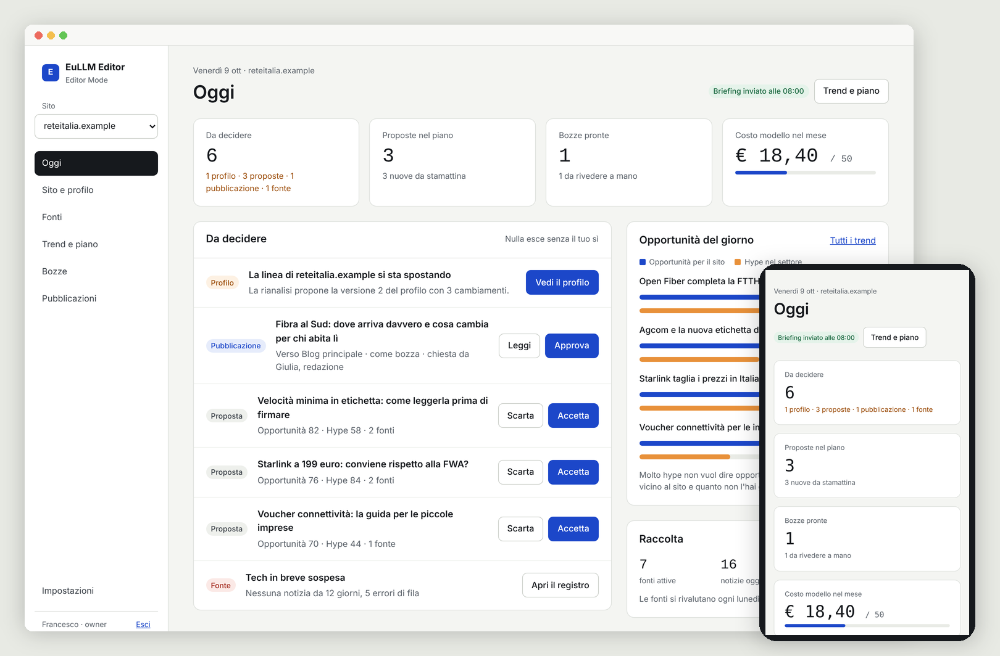
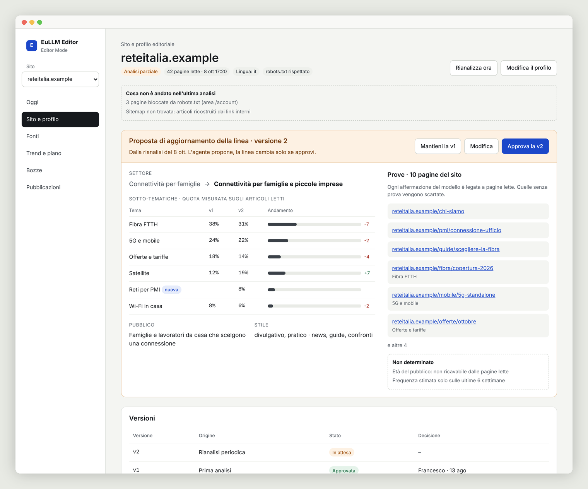
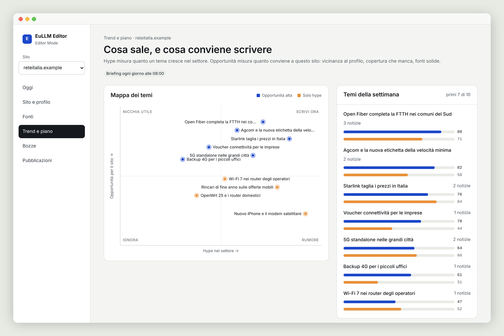
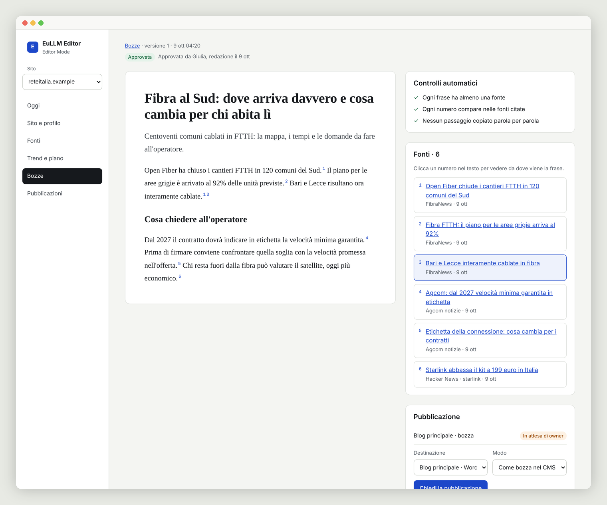
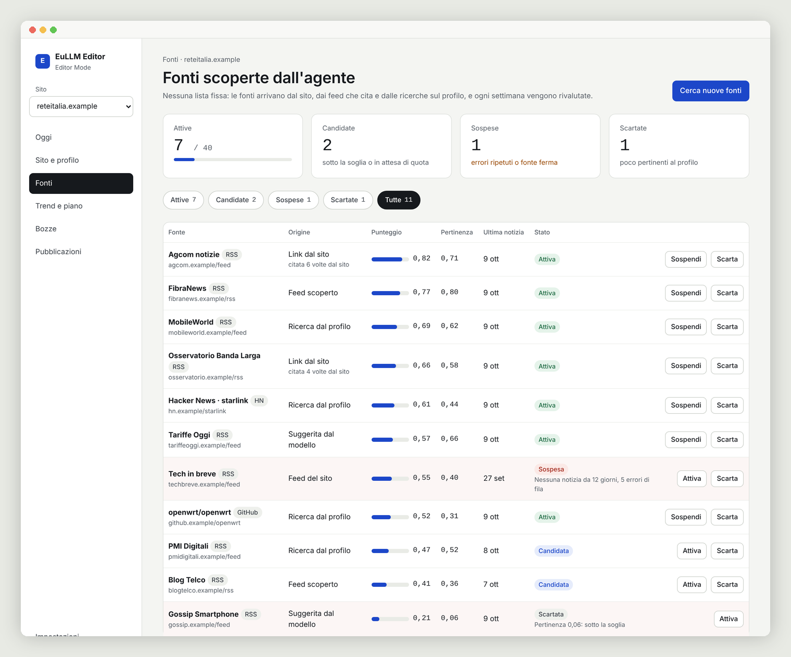

# EuLLM Agent: Editor Mode

Part of EuLLM Agent, licensed under [AGPL-3.0-or-later](../LICENSE). Copyright I3K Technologies Srl.

Editor Mode is the first specialised mode of EuLLM Agent. It runs on top of
the general-purpose Core and never talks to a model provider or to the web
by itself: model calls go through `POST /v1/llm/chat` and every page of a
site under analysis through `POST /v1/fetch` (address checks, size limit,
per-host pace, audit), with the tenant's token.

Domain-first: given a domain, Editor Mode analyses the site, writes a draft
editorial profile with evidence for every choice, discovers and rates
sources, follows trends, scores Hype and Editorial Opportunity separately,
proposes a plan and drafts articles whose every claim cites a stored source.
People approve profiles and every external action.

## Dashboard

Seven pages, server-rendered, no JavaScript needed, same roles and checks as
the API. Viewers read, editors decide proposals and drafts, owners approve
profiles, sources and publications.

| Page | What it does |
| --- | --- |
| **Oggi** | Everything waiting for a decision, the day's top opportunities, plan usage. |
| **Sito e profilo** | The profile with its evidence; on re-analysis, the proposed new line next to the approved one. |
| **Fonti** | Discovered sources with score, origin and status; activate, suspend or reject. |
| **Trend e piano** | Hype against Opportunity on one map, and the plan to accept or discard. |
| **Bozze** | The draft with numbered sources per sentence and the automatic checks. |
| **Pubblicazioni** | Requests waiting for an owner, history, WordPress / GitHub / webhook / Telegram targets. |
| **Impostazioni** | Plan meters, briefing recipients, people of the newsroom (invited by email, with a role), tokens for integrations. |

An approved article reaches the customer's site in four ways, also
together: a connected destination (WordPress, a GitHub repository — for
the static sites deployed from it, Vercel, Netlify, GitHub Pages: the
article in the shape of the blog's own posts, read before writing (front
matter keys and date format, `.md` or `.mdx`, a folder per post, where the
image goes), with its cover, a line in `llms.txt` and the sitemap when it
is a file, in one commit on a pull request merged only once the site's
preview deploy passes; a draft publication stops at the pull request —,
a signed webhook, a Telegram channel, after an owner's yes); an email
to the newsroom's email
recipients with the article and a ZIP package attached (needs SMTP); the
package downloaded from the draft (`article.html` ready to open,
`body.html` to paste into a CMS, `article.md` with front matter for static
sites, the cover image, `meta.json` with the search fields); and the
site's feed, `/feeds/<token>.json` (JSON Feed 1.1, the CMS fields under
`_redazia`) or `.rss`, with the last 50 approved articles, for Zapier,
Make, n8n or a site that imports feeds. The feed is created and its token
changed in Sito e profilo; `?lang=en` keeps one language.

People sign in with email and password and may belong to several
newsrooms. Operator accounts also get the **console** (`/admin`): every
newsroom with plan, limits and usage; create, suspend, delete, invite
owners; API keys for the billing system, which creates a newsroom with
`POST /api/operator/tenants` when a payment goes through (see
[deploy/server](../deploy/server/README.md#newsrooms-people-and-the-billing-system)).
**Getting a site ready.** What a WordPress site, a static site on GitHub
or a custom CMS (webhook) needs to receive the articles, in Italian:
[docs/sito-pronto-per-redazia.md](docs/sito-pronto-per-redazia.md).

**Automatic newsroom.** A site can also run with no one in the loop
(Sito e profilo › Redazione automatica): the owner gives a brief, the
sections, directives, topics to avoid, articles a day and hours; every
hour the best proposals that pass those guardrails are written, given a
cover, read by an AI editor-in-chief against fixed rules (unconfirmed
accusations, private people, medical or financial advice, hate, rumours
as facts, misleading titles) and published, translations included. Each
article says it was written by AI without human review (AI Act art.
50(4)); one button stops everything. A new site with no articles gets its
profile from the brief.

Plans, the 7-day trial, customers' billing data, Mollie payments and
resellers are in [Selling](../deploy/server/README.md#selling-plans-trial-payments-resellers).

<table>
<tr>
<td></td>
<td></td>
</tr>
<tr>
<td align="center">The line is moving: the agent proposes, the owner decides.</td>
<td align="center">Hype is not opportunity: what is worth writing for this site.</td>
</tr>
<tr>
<td></td>
<td></td>
</tr>
<tr>
<td align="center">Every sentence has a source; click a number to see it.</td>
<td align="center">No fixed list: sources are found, rated and re-rated.</td>
</tr>
</table>

Screenshots use demo data on fictitious `.example` domains.

## Setup

Two installations, same code:

- **Local, one user:** `EDITOR_DATABASE_URL=sqlite:///editor.db`. One file,
  created by `editor migrate`, nothing to install; the file holds one tenant
  (a second is refused) and `editor worker` runs one job at a time. Steps 2
  and the `tenant-plan` limits are optional there.
- **Server, several tenants:** PostgreSQL, with row-level security between
  tenants; the worker runs several tenants at once. All the steps below apply.

1. **Core.** Enable fetch and give Editor Mode one delegating token
   (`eullm-agent token new` prints the token and its SHA-256; only the hash
   goes in the file). With `delegate: true` and `EDITOR_CORE_DELEGATE=true`
   every Editor Mode tenant is a Core tenant of its own, `editor/<tenant>`:
   its own usage and audit, and as Core limit the model budget of its plan
   (`editor tenant-plan --max-cost-month` sets both). `delegate_limits`
   applies to a tenant whose plan sets none, so nobody is unlimited by
   omission. A new tenant needs no change to the Core and no restart.

       api:
         tokens:
           - name: editor-mode
             tenant: editor
             token_sha256: "<sha256>"
             delegate: true
             delegate_limits: {max_cost_per_month: 5.0, max_fetches_per_day: 2000}
         fetch: {}

   A tenant can still have a token of its own (`tenant-plan
   --core-token-env`); it is then used instead of the shared one.

2. **Database (PostgreSQL).** The migrations create the schema `editor` and the role
   `editor_app` (NOLOGIN, NOBYPASSRLS). The application connects with a login
   role that is a member of it, so row-level security always applies:

       CREATE ROLE editor_web LOGIN PASSWORD '...' IN ROLE editor_app;

3. **Environment.**

   | Variable | Meaning |
   |---|---|
   | `EDITOR_DATABASE_URL` | application connection (`editor_web`) |
   | `EDITOR_ADMIN_DATABASE_URL` | owner connection, for `migrate` and `tenant-plan` |
   | `EDITOR_CORE_URL`, `EDITOR_CORE_TOKEN`, `EDITOR_CORE_MODEL` | Core address, default token, model or profile name |
   | `EDITOR_CORE_DELEGATE` | `true` when the Core token has `delegate: true`: each tenant acts as Core tenant `<token tenant>/<tenant>` |
   | `EDITOR_WORKER_CONCURRENCY` | tenants the worker runs at the same time (default 2, PostgreSQL) |
   | `EDITOR_TIMEZONE`, `EDITOR_BRIEFING_HOUR` | defaults: Europe/Rome, 8 |
   | `EDITOR_IMAGES_API_KEY`, `EDITOR_IMAGES_MODEL`, `EDITOR_IMAGES_QUALITY`, `EDITOR_IMAGES_PROVIDER`, `EDITOR_IMAGES_URL` | cover images: an OpenRouter key (`sk-or-`) draws with `openai/gpt-image-2` at quality `medium`, any other key with FLUX of Black Forest Labs (`flux-2-pro`, EU endpoint); the model, quality, provider (`openrouter` or `bfl`) and endpoint can be changed; no key, no images |
   | `EDITOR_BASE_NEWS` | default on: about 46 general news feeds (world, economy, technology; English, Italian, German, French, Spanish) read for every newsroom in the shared archive, for the news index and the proposals; `0` turns them off |
   | `EDITOR_RETENTION_DAYS` | collected items and finished jobs older than this are deleted at the daily maintenance (default 365, `0` keeps everything); items cited by a proposal or a draft and model usage are kept |
   | `EDITOR_SMTP_HOST`, `EDITOR_SMTP_PORT`, `EDITOR_SMTP_USER`, `EDITOR_SMTP_PASSWORD`, `EDITOR_MAIL_FROM` | email (STARTTLS): briefing, invites, password resets, trial and payment notices; every email goes as text and as HTML with the Redazia logo |
   | `EDITOR_LANGUAGE` | the language (`en`, `it`, `de`, `fr`, `es`) of the pages for a browser that asks for none of these, and of the emails to the administrators (new newsrooms, payments); customers get theirs in their newsroom's language. Default `en` |
   | `EDITOR_TELEGRAM_TOKEN` | briefing by Telegram |
   | `EDITOR_PUBLIC_URL` | the address people open the dashboard at (https://editor.example.com): links of invites and password resets point there |
   | `EDITOR_SECRET_KEY` | key (32 bytes in base64, `editor secret-key` prints one) of the publishing credentials that owners enter in the dashboard: they are stored encrypted (AES-256-GCM) in `editor.secrets` and never shown again. Without it a server stores none; the local installation keeps its key in `editor-secret.key` next to the database |
   | `EDITOR_SECRET_<TENANT>__<NAME>` | alternative to the dashboard: credentials of a publishing target (WordPress application password, GitHub token, webhook signing key, Telegram channel bot token) set by the operator. The tenant names the target's secret `<NAME>`; the tenant id is upper-cased with `-` as `_`, e.g. `EDITOR_SECRET_RAG_ENTERPRISE__WP`. A credential stored in the database comes first |
   | (Core) `api.fetch.credentials` | optional: a GitHub token for `api.github.com`, set in the Core's config, raises the GitHub API rate limit for source discovery |

4. **First tenant and site.**

       uv run editor migrate
       uv run editor tenant-add editor-acme --name "ACME"
       uv run editor tenant-plan editor-acme --plan pro --max-sites 4 \
           --max-cost-month 40 --core-token-env EDITOR_CORE_TOKEN_ACME
       uv run editor user-add me@example.com --operator --tenant editor-acme   # dashboard login, prints the password (or: editor setup-link, from the browser)
       uv run editor recipient-add --tenant editor-acme --channel email --address me@example.com
       uv run editor site-add example.com --tenant editor-acme
       uv run editor profile-show example.com --tenant editor-acme
       uv run editor profile-approve example.com 1 --tenant editor-acme --by francesco

   `site-add` declares when the analysis is partial or insufficient. Sources
   are collected at once, but no opportunity score or proposal is made for a
   site until a person approves its profile (here or in the dashboard).

5. **Run.**

       uv run editor worker                  # queued work and the hourly tick: collection, briefing at 08:00 local, maintenance, reviews
       uv run editor serve --port 8090       # dashboard and API

A tenant's data: `editor tenant-export <tenant> --out file.json` writes
every row of it, credentials left out (the owner downloads the same file
from Impostazioni, or `GET /api/export`); `editor tenant-delete <tenant>
--confirm <tenant>` deletes it for good, with the owner connection. Its
usage and audit in the Core stay there.

Drafts and publications are started from the dashboard or the API; every
publication waits for an owner's approval. The dashboard only queues work
in `editor.jobs`; the worker runs it, so nothing is lost when either
restarts. A tenant runs one job at a time and tenants are served in turn;
`--concurrency N` (default 2, `EDITOR_WORKER_CONCURRENCY`) sets how many
tenants run at the same time.

## Development

    uv sync
    EDITOR_TEST_DATABASE_URL=postgres://postgres@localhost:5432/postgres uv run pytest

Every database test runs on SQLite (a new file per test) and on
PostgreSQL; the PostgreSQL run creates and drops its own database and is
skipped without the variable. Tests marked `postgres` (row-level security,
roles, several tenants) run on PostgreSQL only.

A migration that changes tables is written twice: an Alembic revision in
`src/editor/migrations/versions/` and a numbered SQL file in
`src/editor/migrations_sqlite/`; `test_same_columns_as_postgres` checks
that the two schemas have the same columns.
